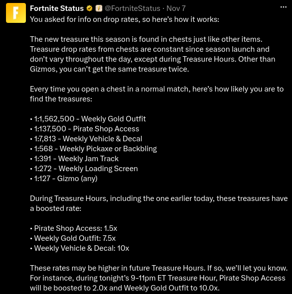

+++
date = '2026-11-10T13:00:00Z'
draft = false
title = "Will the Next Chest Be the One? The Mathematics of the Fortnite Pirate Shop Access Token."
tags = ['Mathematics', 'Statistics', 'Probability', 'Video Games', 'Fortnite']
+++


In the latest season of [Fortnite: Battle Royale](https://en.wikipedia.org/wiki/Fortnite_Battle_Royale) (1 November – 1 December 2026),
Epic Games has introduced a new twist to the familiar queue-loot-die cycle:
players now have the opportunity to obtain cosmetics and additional in-game
items when opening the various types of chests scattered across the map.

These rewards range from pickaxes to vehicle and player models which vary weekly.
However, one reward has attracted considerably more attention than the rest:
the highly coveted **Pirate Shop Access Token** (referred to henceforth as "the token").
This token grants its winner free access to the entire Fortnite Item Shop
during two separate two-week periods, one in 2026 and another in 2027.

This blog post aims to discuss the token using rigorous mathematics, particularly
in the case that chests are independent. More generally, however, we discuss a
common misconception: the Gambler's Fallacy: the belief that a run of fails somehow
makes a success more likely.

## Understanding the Drop Rates

### What Has Been Confirmed?
At the time of writing, Epic Games has officially released the odds of obtaining the
possible rewards [on X](https://x.com/FortniteStatus/status/2119202610322227327?s=20).

We are interested in the 1:137,500 odds of obtaining the token. In this post,
we take this to mean that *on average* we have 1 success for every 137,500 failures.
Thus, the *probability* of obtaining the token is \\(p = 1\/137501\\).

The above post refers to *Treasure Hours*. These are pre-defined, well-advertised
time intervals in which the probabilities of obtaining the treasures change.
During these intervals, the token's odds are boosted by 1.5x.

### Do Constant Drop Rates Imply Independence?
We say two events \\(A\\) and \\(B\\) are **independent** if and only if \\(\mathbb{P}(B) > 0\\) and
\\[
    \mathbb{P}(A|B) = \mathbb{P}(A)
\\]
that is, the probability of event \\(A\\) happening, given that event \\(B\\) has
happened, is the same as the probability of event \\(A\\) happening in general. It
quite literally means that event \\(B\\) doesn't have an impact on event \\(A\\), i.e.
that they are independent in the literal sense.

A consequence of events \\(A\\) and \\(B\\) being independent is the definition
which is commonly given in introductory probability courses:
\\[
    \mathbb{P}(A \cap B) = \mathbb{P}(A) \mathbb{P}(B)
\\]

It is important that Epic's confirmation that the drop rate of the token is constant
for each chest is not misconstrued for some sort of confirmation that each chest
is an independent chance of obtaining the token.

We illustrate this with a small example. Suppose we have two boxes. Let \\(B_1\\) be
the event that the first box contains a special prize and \\(B_2\\) be the event that
the second box contains a special prize. Additionally, suppose there are only two
possibilities:

1. \\(A\\): all boxes contain a prize with \\(\mathbb{P}(A) = p\\)
2. \\(N\\): no box contains a prize with \\(\mathbb{P}(N) = 1 - p\\)

Using the [Law of Total Probability](https://en.wikipedia.org/wiki/Law_of_total_probability),
we can express the probability that the first box contains a prize as
\\[
    \mathbb{P}(B_1) = \mathbb{P}(B_1|A) \mathbb{P}(A) + \mathbb{P}(B_1|N) \mathbb{P}(N) = 1 p + 0 (1-p) = p
\\]
Similarly for \\(B_2\\):
\\[
    \mathbb{P}(B_2) = \mathbb{P}(B_2|A) \mathbb{P}(A) + \mathbb{P}(B_2|N) \mathbb{P}(N) = 1 p + 0 (1-p) = p
\\]

Therefore, the probability of each box containing a prize is constant, i.e. \\(\mathbb{P}(B_1) = \mathbb{P}(B_2) = p\\).
However, the events \\(B_1\\) and \\(B_2\\) are certainly dependent since if the first
box contains a prize, then all boxes must contain a prize and so
\\[
    \mathbb{P}(B_2|B_1) = 1 \ne \mathbb{P}(B_2)
\\]

Nonetheless, the remainder of this blog post will assume that each chest is independent.
We do this since Epic Games has not publicly confirmed that there is some mechanism
which modifies the probability based upon previous chest openings and thus there
is no particular reason to introduce dependence between them. However, readers must
keep in mind that this is an assumption and not an established fact.

## Building a Probability Model
We shall now formulate a model for the number of chests \\(X\\) that we must open
in order to obtain the token. We take the confirmed \\(p = 1\/137501\\)
to be the probability that we obtain the token from an individual chest. Additionally,
we assume that each chest opening is independent. For simplicity, we do not consider
the Treasure Hours. However, a separate model can be reconstructed for Treasure Hours
by using \\(p^\prime = 1.5 p\\) in place of \\(p\\).

### Introducing Random Variables
A random variable is a way of assigning a numerical value to each possible outcome
of a process.
Formally, let \\(\Omega\\) be the set of all possible outcomes of a process. Then
a random variable \\(Y\\) is a map \\(\Omega \rightarrow \mathbb{R}\\). 

Suppose we flipped a fair coin 3 times. We can model the number of heads as a random
variable \\(Y\\). The set of all possible outcomes is
\\[
    \Omega = \left\\{ HHH, HHT, HTH, HTT, THH, THT, TTH, TTT \right\\}
\\]
Here, \\(THT\\) denotes getting a tail on the first and third flips, and heads on the second.
Thus, for example, \\(Y(HHH) = 3\\), \\(Y(HTH) = 2\\), \\(Y(TTH) = 1\\) and \\(Y(TTT) = 0\\).

The set of possible outcomes of \\(Y\\) is known as the range of \\(Y\\) and is denoted \\(R_Y\\).
In this example, \\(R_Y = \left\\{0, 1, 2, 3\right\\}\\).

### Modelling Individual Chest Openings
We say that a random variable \\(B \sim \text{Bern}(p)\\), i.e. that \\(B\\) is
a Bernoulli distributed random variable with probability \\(p\\), if and only if

1. \\(R_B = \left\\{0, 1\right\\}\\)
2. \\(\mathbb{P}[B = 1] = p\\)

We can think of Bernoulli random variables as coin flips where we represent
heads and tails as 1s and 0s respectively, and take \\(p\\) to be the probability
that the coin lands on heads.

Therefore, it should make sense that we can model the outcome of an individual chest as a Bernoulli
random variable. Formally, we define a sequence of _independent and identically distributed_
random variables \\(C_1, C_2, \dots\\).

- Independent since, for example, the outcome of \\(C_5\\) does not depend on \\(C_1, C_2, C_3\\) or \\(C_4\\)
- Identically distributed since for all integers \\(i > 0\\), \\(C_i \sim \text{Bern}(p)\\)

### Modelling The Waiting Time
However, we are not interested in a single chest opening. We are, in fact, interested in
\\(X\\) which is the smallest index of the chest which grants us the token. For example,
if \\(X = 5\\) then in terms of our Bernoulli chest variables, we have \\(C_1 = C_2 = C_3 = C_4 = 0\\) and \\(C_5 = 1\\).
Therefore, by independence
\\[
    \mathbb{P}[X = 5] = \mathbb{P}[C_1 = 0] \times \cdots \times \mathbb{P}[C_4 = 0] \times \mathbb{P}[C_5 = 1] = (1-p)^4 \times p
\\]

We say that \\(G \sim \text{Geom}(p)\\), i.e. that \\(G\\) is a geometrically distributed
random variable with probability \\(p\\), if and only if

1. \\(R_G = \left\\{1, 2, 3, \dots \right\\}\\)
2. \\(\mathbb{P}[G = g] = p (1-p)^{g-1}\\)

Therefore, it is clear that \\(X \sim \text{Geom}(p)\\).

We are able to use \\(X\\) to answer questions like: "what is the probability
I will need more than \\(n\\) chests to obtain the token?". This translates to
the calculation
\\[
    \mathbb{P}[X > n] = (1-p)^n
\\]
More importantly, we can ask ourselves "what is the probability that a run of \\(n\\) chests
will give me the token?". This is answered by
\\[
    \mathbb{P}[X \le n] = 1 - \mathbb{P}[X > n]
\\]

## Putting the Model to Work
Under the model proposed in the last section, we can debunk some of the common
misconceptions made by Fortnite players about their chances of obtaining the token.

### Does Opening 137,501 Chests Guarantee the Token?
Absolutely not, using the model, the probability of getting the token in this amount
of chests is
\\[
    \mathbb{P}[X \le 137501] = 1 - (1 - p)^{137501} \approx 63.21\\%
\\]
Therefore, opening 137501 does not guarantee the token and, in fact, you have a
\\(36.79\\%\\) chance of _not_ obtaining the token in that amount of chests,
which is quite substantial.

### How Many Chests For a 95% Chance?
In terms of the model, we want to know the value of \\(n\\) such that
\\(\mathbb{P}[X \le n] = 0.95\\), i.e. we wish to solve the following equation
for \\(n\\):
\\[
    (1-p)^n = 0.05 \implies n = 411,914.6855
\\]
Thus we would need a run of \\(n = 411,915\\) chests to have a probability
of at least \\(95\\%\\) of obtaining the token.

However, it is important that this statistic does not get misconstrued. If we open
\\(411,914\\) chests without obtaining the token, this **does not** mean that
the next chest has a 95% chance of providing the token. This is something which
we address in the next subsection.

### The Gambler's Fallacy and Memorylessness
The Gambler's Fallacy is the belief that previous outcomes in a sequence of independent random events
make future outcomes more or less likely. 

In the last subsection, we showed that a run of \\(411,915\\)
chests has a \\(95\\%\\) chance of providing the token. Someone who believes the
Gambler's Fallacy might say: "if I opened \\(411,999\\) chests without getting the token,
then the next chest must be extremely likely to give it to me!".

Under our independence assumption, this is not the case. This is because the probability
of obtaining the token from the next chest remains \\(p\\) regardless of the outcome
of the previous chests. This is the intuition behind the disproof of the Gambler's Fallacy:
previous failures _do not_ affect the chances of future success.

This idea extends beyond the probability of a single success. Even after
opening hundreds of thousands of chests without finding the token, the probability
of finding it in the next \\(n\\) chests is exactly the same as it was in the beginning.
This is a property of the geometric distribution known as **memorylessness**, which
can be expressed as
\\[
    \mathbb{P}[X \le n + m | X > m] = \mathbb{P}[X \le n]
\\]
for integers \\(n, m \ge 0\\). This can equivalently be written as
\\[
    \mathbb{P}[X > n + m | X > m] = \mathbb{P}[X > n]
\\]
We will prove memorylessness by applying the definition of conditional probability
to the latter statement of memorylessness. In general, for any events \\(A\\) and \\(B\\),
the conditional probability \\(\mathbb{P}(A|B)\\), i.e. the probability of \\(A\\) occurring _given that_ \\(B\\) has occurred is
\\[
    \mathbb{P}(A|B) = \frac{\mathbb{P}(A \cap B)}{\mathbb{P}(B)}
\\]

We expand the definition of the left hand side and observe that the
intersection \\(\left\\{X > m + n\right\\} \cap \left\\{X > m\right\\} = \left\\{X > m + n\right\\}\\)
since \\(n, m \ge 0\\). Therefore, by definition
\\[
    \mathbb{P}[X > n + m | X > m] = \frac{\mathbb{P}[X > n + m]}{\mathbb{P}[X > m]} = \frac{(1 - p)^{n + m}}{(1-p)^m}
\\]
\\[
    = (1-p)^n = \mathbb{P}[X > n]
\\]
as required.

## Conclusion
In conclusion, we have demonstrated how we can use probability theory in order to
understand the chances of obtaining the Pirate Shop Access Token. Under the proposed
model, opening \\(137,501\\) chests gives players approximately a \\(63.21\\%\\) chance
of obtaining the token, while opening \\(411,915\\) chests raises this probability to at least \\(95\\%\\).
However, neither of these guarantees success.

More importantly, we've seen that these calculations rely on the assumption that
each chest opening is an independent random event. Although Epic Games has officially
confirmed that the token's drop rate is constant, this must not be mistaken for confirmation
that each chest opening is independent. Hence, the precise numerical results must
be understood within the context of our assumptions rather than definitive predictions
of how the game actually handles the chest drop rates.

Nonetheless, even if our independence assumption is mistaken, this does not detract
from the broader lessons of the post. I hope that readers have gained an appreciation
for some of the probabilistic tools available to us for modelling independent events and, at the very least,
a better understanding of why misconceptions, such as the Gambler's Fallacy, are indeed
misconceptions in these settings.

Ultimately, probability theory is not just about calculating numerical values,
but also about the intuition behind those values and the assumptions from which
they are derived.
