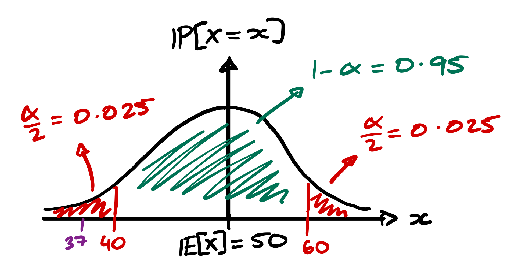
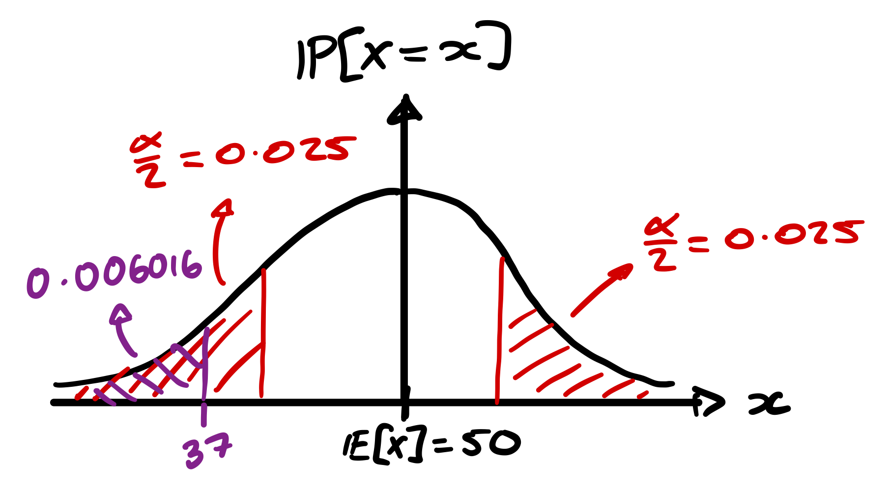
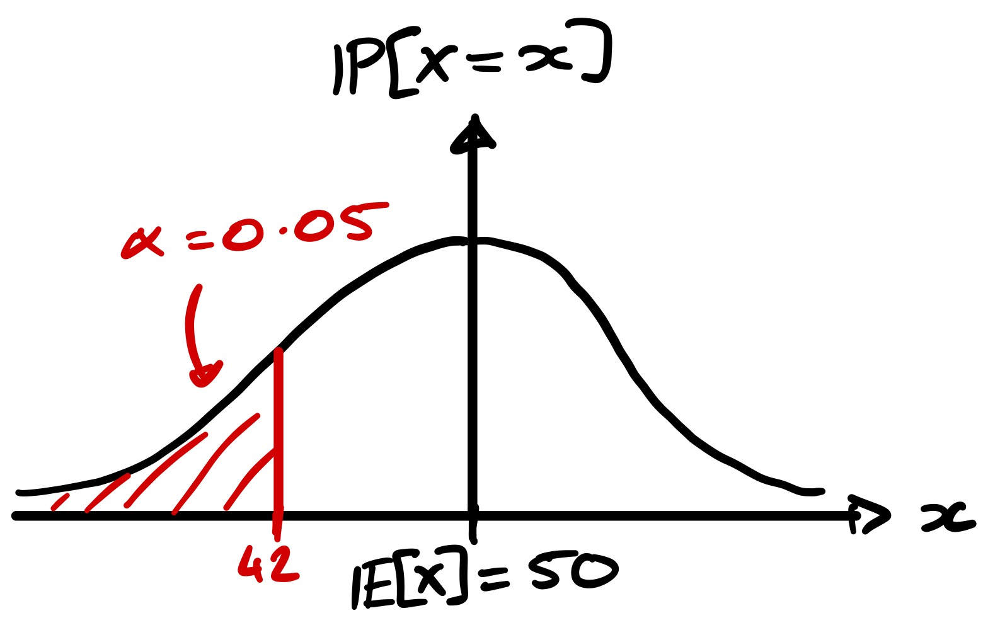

+++
date = '2026-10-13T19:00:00Z'
draft = false
title = 'Hypothesis Testing: Rigour without Certainty'
tags = ['Mathematics', 'Statistics']
+++


## Introduction
At the start of my degree, I fell in love with mathematics because I loved
the fact that every statement can be derived and proven from axioms and definitions.
I found it deeply satisfying that everything presented by lecturers could be
proven or disproven.

This is why, for a long time, I struggled to enjoy statistics. Unlike the mathematics
I had grown accustomed to, statistics seemed to involve an element of subjectivity;
it was rare that a conclusion could be reached with absolute certainty. Nonetheless,
I keep revisiting statistics since it appears very frequently across many STEM disciplines
because it underpins much of the scientific method, with wide-ranging applications from
biology and physics to psychology and economics.

This article is going to demonstrate that one can simultaneously love formal
mathematical proofs as well as experimental study by introducing the _Hypothesis
Testing Framework_.

## Hypothesis Testing Framework
Suppose you flip a coin 100 times and observe 37 heads. What can we say about the coin?
Are these 100 flips sufficient to say that the coin is biased? Do we need to do
more testing? It is possible that either the coin is biased, or we were simply unlucky
with a fair coin. Hypothesis testing provides us with a principled way to distinguish
between these two conflicting explanations, in the same way that mathematical proof
techniques provided principled approaches to demonstrating the correctness of a statement.

In a hypothesis test, we describe the two possible outcomes formally as the
null hypothesis and the alternative hypothesis. The null hypothesis is typically
the "default" belief, e.g. in the coin scenario, our null hypothesis would be that
"the coin is fair". The alternative hypothesis is the "alternative explanation", e.g.
"the coin is biased". We typically write these in mathematical notation, denoting
the null hypothesis as \\(H_0\\) and the alternative hypothesis as \\(H_A\\). Therefore,
for the example above we would write:

\\(H_0: p = 1/2\\)

\\(H_A: p \ne 1/2\\)

where \\(p\\) denotes the probability of obtaining a head from a single coin flip.

In a general sense, the hypothesis testing framework has 4 steps:

1. Define a _null hypothesis_ (\\(H_0\\)) and an _alternative hypothesis_ (\\(H_A\\)).
2. Specify a statistical model under \\(H_0\\) and included assumptions about the observations.
3. Determine how unusual our observation is under the aforementioned model.
4. Use a prespecified decision rule to either reject \\(H\_0\\) or fail to reject \\(H_0\\).

The following sections will concentrate on how to quantify the "unusualness"
of our observations, as well as provide examples of such "decision rules".

One thing that I wish to draw attention to is the wording of "reject" and "fail to reject".
At no point do we say "accept \\(H_A\\)" or "accept \\(H\_0\\)". This is very important since
our test can only measure how compatible our observations are with \\(H_0\\), but can not
prove or disprove the null hypothesis definitively.

This is the key difference between mathematical proofs and hypothesis tests.
Mathematical proofs establish a conclusion using given premises and rules of inference;
thus if the premises are true, and the reasoning is valid, the conclusion is necessarily
true with 100% certainty. On the other hand, hypothesis tests use empirical observations
in order to assess a hypothesis under a statistical model. This means that conclusions
made by hypothesis testing are subject to some level of uncertainty.

## Significance Levels and Rejection Regions 
We define the boundary between rejection, and failing to reject \\(H_0\\) using
a _significance level_ (usually denoted by \\(\alpha\\)). This is the probability
of rejecting \\(H\_0\\) in the case that it is actually true, i.e. the probability
of an "incorrect rejection". More often than not, we use \\(\alpha = 0.05\\) but values
may vary depending on application. 

We are going to statistically test whether the coin flipped in the experiment at the
start of the last section is biased with \\(\alpha = 0.05\\). Recall that we flipped a coin 100 times and
observed 37 heads. We begin by defining our hypotheses:

\\(H_0: p = \frac{1}{2}\\), i.e. the coin is fair.

\\(H_A: p \ne \frac{1}{2}\\), i.e. the coin is biased.

Assuming that the null hypothesis is true, since each coin flip is independent
with assumed probability \\(\frac{1}{2}\\) of showing heads,
we can model the number of heads \\(X\\) achieved through the experiment using
the [binomial distribution](https://en.wikipedia.org/wiki/Binomial_distribution), i.e. \\(X \sim \text{Bin}\left(100, \frac{1}{2}\right)\\).

In order to decide whether to reject or fail to reject \\(H_0\\) we wish to construct
a decision rule using \\(\alpha\\) which identifies unusually high and unusually low
numbers of heads under the binomial model.

We do this using a two-tailed test in which we split \\(\alpha\\) between the two
tails of the distribution. We reject \\(H_0\\) when it falls into either "rejection
region", and fail to reject it otherwise. We illustrate this thinking below:

Thus our job is to determine the boundaries of the 95% _probability interval_
(coloured green in the diagram). That is, we wish to find \\(a, b\\) such that
\\(\mathbb{P}\left\[a \le X \le b\right\] \approx 0.95\\).

There are a variety of possible methods to do this: software, calculator, tables, by hand.
However, since we are working with discrete data, it is not necessarily possible
to identify an interval with associated probability of exactly 95%. Thus, we choose
the central interval \\(40 \le X \le 60\\), which has associated probability ~96%.

Thus, since we observed 37 heads, and \\(37 < 40\\), we reject \\(H_0\\) and report
that there is sufficient evidence to suggest that \\(p \ne \frac{1}{2}\\).

## An Alternative Approach: \\(p\\)-values
Rather than defining a rejection rule based on probability intervals, we can also
use \\(p\\)_-values_. A \\(p\\)_-value_ is a probability of seeing a test statistic
(a test result) at least as extreme as the one observed, assuming the null hypothesis
and the chosen statistical model is correct. The notion of "extremeness" depends
on our chosen hypothesis test, and the exact probability we calculate depends on the application.
For example, for "low extremes", we would
calculate \\(\mathbb{P}\left\[X \le x\right\]\\) and for "high extremes" \\(\mathbb{P}\left\[X \ge x\right\]\\).

We repeat the previous test with this technique to illustrate the difference.
Our setup is exactly the same:

\\(H_0: p = \frac{1}{2}\\)

\\(H_A: p \ne \frac{1}{2}\\)

tested with \\(\alpha = 0.05\\). Assuming the null hypothesis, we can model the number
of heads observed by experiment as \\(X \sim \text{Bin}\left(100, \frac{1}{2}\right)\\).

There are two ways to make a comparison. The first is to calculate the exact \\(p\\)-value.
Since this is a two-tailed test on a symmetric distribution,
this would be \\(2 \mathbb{P}\left\[X \le 37\right\] \approx 0.012 < \alpha\\).
Therefore, we reject \\(H_0\\).

The alternative is, since 37 sits in the left tail, to calculate the left tail
probability and compare to the significance level which was allocated to the left tail.
This is the procedure illustrated in the diagram. We calculate and find that
\\(\mathbb{P}\left\[X \le 37\right\] \approx 0.006016 < 0.025\\) and so we reject
\\(H_0\\).

## Variability of Testing
Of course, the results of our hypothesis tests depend on a few things. The obvious
one is the choice of \\(\alpha\\). For example, in theory, we could choose \\(\alpha = 1\\)
and thus _always_ reject \\(H_0\\).

However, our choice of hypothesis can also change the results. Consider the same
experiment as before, except this time we observe 41 heads. Under the same hypotheses,
we would fail to reject \\(H_0\\), since 41 lies in our probability interval (\\(40 < 41 < 60\\)).

Now, suppose we wish to test for _biasness towards tails_, rather than general biasness.
Our alternative hypothesis would now become:

\\(H_A: p < \frac{1}{2}\\)

This means that we now carry out a "one-tailed test" with the significance level
completely contained in the left tail.

Our \\(p\\)-value here is \\(\mathbb{P}\left\[X \le 41\right\] \approx 0.04431 < \alpha\\).
Thus we reject \\(H_0\\) and conclude that \\(p < \frac{1}{2}\\). Hence, changing the hypothesis
has caused us to reject \\(H\_0\\).

The important distinction is that the two hypotheses answer slightly different questions.
The first suggests that the coin is biased in general, whereas the second suggests
that the coin is biased _towards tails_, i.e. it is more likely to show tails than heads.

Therefore, in general it is important that experiments which rely on hypothesis tests
follow the following steps:

1. Design the hypotheses and experiment.
2. Carry out the experiment.
3. Carry out the hypothesis test.

Ensuring that the hypotheses are set in stone before seeing experimental data
is the best defense against [HARKing](https://en.wikipedia.org/wiki/HARKing).
However, exploring data can be valuable for hypothesis generation. If exploratory
analysis is used to inform hypothesis design, then these hypotheses should be
tested using new data, or by using a particular method which accounts for such a process.
The important thing is that the hypotheses are not presented as being designed
_before_ the experiment.

## Conclusion
At the start of this article, I explained how I initially struggled to enjoy
statistics because of its apparent subjectivity. Unlike mathematical proofs,
which allow us to establish conclusions deductively from a set of premises,
statistical methods deal with observations with inherent uncertainty.

However, as demonstrated, this doesn't mean that statistical reasoning is
any less rigorous. Hypothesis testing provides a formal framework for evaluating
competing explanations of observed data. By following the steps of the framework,
we are able to make principled decisions in situations where absolute certainty
is impossible.

Though, it is important to realise that the assumptions we make, and the questions
which we choose to ask can influence the conclusions that we reach. It is important
that such decisions are made before an experiment is carried out in order to reduce
bias.

Ultimately, mathematical proofs and hypothesis testing serve different roles
in a mathematician's toolkit. While hypothesis testing cannot _prove_ that a coin
is fair or biased, it provides a rigorous way to reason about a world in which
observations do not provide certainty. It is thus important to understand that mathematical
rigour and empirical uncertainty are not mutually exclusive.
