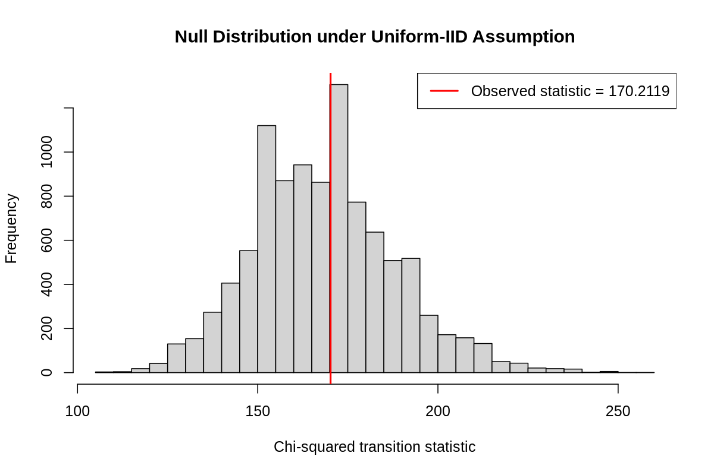

+++
date = '2026-10-15T19:00:00Z'
draft = false
title = 'Bad Luck or Vendetta? A Statistical Investigation of VALORANT Map Selection'
tags = ['Mathematics', 'Statistics', 'R', 'Video Games', 'VALORANT']
+++


## Introduction
In my [previous post](https://www.jensoncain.co.uk/posts/rigour-without-certainty),
I introduced the fundamentals of hypothesis testing. This post aims to explore how
these techniques can be applied to real-world data, particularly in an unconventional setting.
I want to demonstrate that while hypothesis testing is a formal, principled process, it can
still be applied to seemingly trivial everyday experiences.

[VALORANT](https://en.wikipedia.org/wiki/Valorant) is an online [first person shooter](https://en.wikipedia.org/wiki/First-person_shooter)
which I have spent many hours playing. As of late June 2026, the game features [13
standard maps](https://playvalorant.com/en-us/maps/), each with their own unique design and characteristics. Due to the diversity
in the map pool, players naturally develop preferences for which maps they enjoy to play,
and which maps they are keen to avoid.

Unlike similar games, like [Counter Strike](https://en.wikipedia.org/wiki/Counter-Strike_2),
players have no control over which map they get to play. The competitive gamemode
features only a subset of the 13 maps but the unrated (non-competitive) gamemode,
which I typically play, features the full set of 13.

Whenever I play with friends, we often find ourselves complaining about the map selection.
We feel as if we get the maps we dislike ([Pearl](https://valorant.fandom.com/wiki/Pearl))
far more often than the ones we enjoy ([Ascent](https://valorant.fandom.com/wiki/Ascent)),
despite the fact that the selection process is supposedly random. But is this just bad luck,
or is there evidence that the process is not as random as we originally thought.

This post aims to investigate this question, using the principles of hypothesis testing
discussed in the previous post.

## Designing the Test
### Formulating the Hypotheses
We particularly aim to investigate whether VALORANT's _unrated_ map selection
process can be reasonably modelled as a sequence of [independently and identically distributed](https://en.wikipedia.org/wiki/Independent_and_identically_distributed_random_variables) (iid)
uniformly distributed random variables.

We can formulate the hypotheses mathematically as follows. Let \\(\mathcal M\\) denote
the set of all VALORANT maps. Let \\(\left(M_t\right)_{t \in \mathbb{N}}\\) be a sequence of random
variables where \\(M_t\\) represents the map played on the \\(t\\)-th unrated match. Then
we can write our hypotheses as:

\\(H_0: \left(M\_t\right)\_{t \in \mathbb{N}}\\) are iid \\(\text{Unif}(\mathcal M)\\)

\\(H_A: \left(M\_t\right)\_{t \in \mathbb{N}}\\) do not follow this model. 

Under \\(H_0\\), every map is equally likely to be selected, and the selection of each map
is independent of any previous map selections. Under \\(H_A\\) at least one of these
assumptions do not hold, i.e. either each map is not equally likely to be selected, or there
is dependence on previous map selections.

We shall test these hypotheses at the \\(\alpha = 0.05\\) significance level.
### Data Collection
The data was taken from my friend's unrated games (in-game name will be kept
hidden for anonymity) from 25th June 2026 - 14th August 2026. The dataset
consists of a chronological list of map names transcribed from their [tracker.gg](https://tracker.gg/valorant/)
profile, detailing the maps played during their 152 unrated games during these dates.
The precise dataset (along with the R scripts used to carry out the tests
in this article) can be found in the companion repository. The link can be found
at the end of this post.

### Building the Test
Due to the moderately low number of observations compared to the number of possible
map transitions, we cannot reliably use the usual theoretical \\(\chi^2\\) approximation
for our test statistic. Instead, we shall approximate the null distribution through simulation.

Nonetheless, we will still make use of the test statistic used for the \\(\chi^2\\) test.
That is, for \\(K\\) categories, observed category frequencies \\(O_1, \dots, O_K\\)
and expected frequencies under the null hypothesis \\(E_1, \dots, E_K\\):
$$
    X^2 = \sum_{k=1}^K \frac{\left(O_k - E_k\right)^2}{E_k}
$$
The intuition behind this statistic is that it uses consecutive transition frequencies in order to measure how far the observed
frequencies deviate from the null hypothesis. Therefore, a higher \\(X^2\\) implies
a further deviation from \\(H\_0\\) and thus our \\(p\\)-value is calculated from
the probability
\\(\mathbb{P}[X^2 \ge x^2]\\)
where \\(x^2\\) is the statistic calculated from our data.

### Simulating the Null Distribution
Under our null hypothesis, each map is selected independently and uniformly at random
from the complete set of 13 maps. We thus simulate \\(B=10,000\\) sequences of 152
maps (the same amount as our dataset), according to such a model.

For each simulated sequence, we construct a \\(13 \times 13\\) transition table \\(\mathbf{O}\\).
Each entry \\(O_{ij}\\) is the number of times map \\(i\\) is immediately followed by map \\(j\\).
Since a sequence of 152 maps gives us a sequence of 151 transitions, we have that \\(\sum_{i=1}^{13} \sum_{j=1}^{13} O_{ij} = 151\\).

Additionally, under the null hypothesis, every possible transition has a probability of
\\(1/13^2 = 1/169\\) of occurring at any given point in the sequence. Consequently, we have
that for all \\(i = 1, \dots, 13\\) and \\(j = 1, \dots, 13\\)
$$
    E_{ij} = \frac{151}{169}
$$

Thus we calculate the statistic
$$
    X^2 = \sum_{i=1}^{13} \sum_{j=1}^{13} \frac{(O_{ij} - E_{ij})^2}{E_{ij}}
$$
for each simulated sequence, as well as for our observed sequence. The repetition of this
calculation allows us to approximate its null distribution.

Finally, we can use these simulated statistics in order to calculate the \\(p\\)-value.
Since we have a finite set of simulated statistics, we can approximate this directly:
$$
\hat{p} = \frac{1 + \sum_{b=1}^B \mathbf{1}[X^2_b \ge X^2_\text{obs}]}{B+1}
$$
where \\(X^2_b\\) is the statistic calculated for the \\(b\\)-th simulation, \\(X^2_\text{obs}\\)
is the statistic calculated from our observation (i.e. the data) and \\(\mathbf{1}[\cdot]\\) is the
indicator function, i.e.
$$
    \mathbf{1}[\text{condition}] = \begin{cases}
        1 & \text{condition is true} \\\\
        0 & \text{condition is false}
    \end{cases}
$$
The addition of 1 to the numerator and denominator of \\(\hat{p}\\) is the standard
adjustment for Monte-Carlo \\(p\\)-value estimates.

Therefore, a small \\(p\\)-value would indicate that our observed transition frequencies
are unusual under the null hypothesis, thus providing evidence against it.

## Results
Running the script with \\(B = 10,000\\) simulations, we formed the null distribution
illustrated in the histogram below.

We calculated the \\(p\\)-value associated with the observed statistic \\(170.2119\\)
to be \\(0.4622 > \alpha\\). Hence we fail to reject \\(H_0\\).
Therefore, there is insufficient evidence to suggest that VALORANT map selection
deviates from the uniform iid model.

## Conclusion
In this post, we set out to investigate whether or not VALORANT's unrated map selection
could reasonably be modelled as independent and identically distributed uniformly
random selections from the available map pool.

Using the chronological history of 152 unrated games, we constructed a test statistic
inspired by Pearson's \\(\chi^2\\) test statistic, that is based upon consecutive
map transitions. We then simulated 10,000 sequences under the assumed uniform model
in order to approximate the null distribution.

Our observed statistic was \\(170.2119\\) with \\(p\\)-value \\(0.4622\\) which
certainly exceeded the significance level \\(\alpha = 0.05\\) and thus we failed
to reject the null hypothesis. This means that the dataset provides
insufficient evidence to suggest that the transition frequencies are inconsistent
with the proposed model.

However, we reiterate that this is _not definitive proof_ that VALORANT unrated
maps are indeed selected independently and uniformly. Other forms of non-randomness
may exist in the map selection process which our test is not suited to detect.

Our test also comes with a few limitations. Firstly, the dataset is comprised of
a single player's match history. Therefore, the results shown in this post may not
generalise to the wider player population. Secondly, our test focuses on consecutive
map transitions and thus may not be able to detect complicated dependencies between
map selections.

Ultimately, this problem serves as an example of how hypothesis testing can turn an
everyday inklings into a precise statistical question which can be investigated
with mathematical rigour.

----------------------

## Repository


